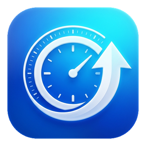

# AppWatch

<p align="center">
  
</p>

<p align="center">
  <strong>Fast, intelligent update manager for Windows desktop applications.</strong><br>
  Track and update software from GitHub Releases, WinGet, portable archives, standalone executables, and external updaters in one unified Fluent Design dashboard.
</p>

<p align="center">
  <a href="README.md"><b>English</b></a> • <a href="README.ru.md">Русский</a>
</p>

<p align="center">
  <a href="https://github.com/skllfi2/AppWatch/actions/workflows/ci.yml"></a>
  <a href="https://github.com/skllfi2/AppWatch/releases"></a>
  <a href="https://dotnet.microsoft.com/download/dotnet/10.0"></a>
  <a href="https://learn.microsoft.com/windows/apps/winui/winui3/"></a>
  <a href="LICENSE"></a>
</p>

---

## Key Features

| Capability | Description |
|---|---|
| **Multi-Source Engine** | Tracks **GitHub Releases** (portable zip, single exe, setup), **WinGet** packages, local programs, and **External** auto-updating tools (such as Battle.net or Steam). |
| **Native WinUI 3 UI** | Windows 11 Fluent Design with Mica material backdrop, responsive navigation, and seamless Light/Dark/System theme switching. |
| **Sound System** | Native WinUI 3 audio cues for user actions, status changes, and notifications with full settings toggle. |
| **Smart Icon Discovery** | High-resolution icon extraction directly from `.exe` binaries via Win32 Shell API with safe GDI handle cleanup, plus heuristic fallback to GitHub repository assets (`assets/icon.png`, `logo.png`). |
| **System Scanner** | Automatic discovery of installed applications across Windows registry (ARP) and WinGet packages without cluttering your feed. |
| **GitHub Stars Import** | Batch import repositories you have starred on GitHub that release Windows binaries in a single click. |
| **Source & Status Filters** | Quickly organize large app collections with source chips (**GitHub**, **WinGet**, **External**) and status chips (**Updates**, **Errors**, **Up to date**). |
| **Process-Aware Updates** | Checks if an application is currently running before updating to prevent file locking errors (`Access Denied`), with optional auto-restart. |
| **Silent Background Checks** | Non-intrusive periodic background checks with consolidated Windows notification center summaries and automatic memory working set trim to 40-60 MB. |
| **Localization** | Full bilingual support (English and Russian) with instant in-app switching. |

---

## Installation

### Via GitHub Releases (Recommended)
1. Navigate to [Releases](https://github.com/skllfi2/AppWatch/releases/latest).
2. Download `AppWatch-win-Setup.exe` (Velopack installer with auto-update) or `AppWatch-win-Portable.zip`.
3. Launch `AppWatch.exe`.

### Via Windows Package Manager (WinGet)
```powershell
winget install AppWatch
```

---

## Architecture & Tech Stack

AppWatch is structured following **Clean Architecture** and **MVVM** principles:

```
AppWatch/
├── src/
│   ├── AppWatch.Core/            # Pure Domain: models, heuristics, update policies, interfaces
│   │                            # Zero dependencies on UI or OS-specific APIs.
│   │
│   ├── AppWatch.Infrastructure/  # Concrete implementations: GitHub API client, WinGet service,
│   │                            # Process management, registry scanners, file system stores.
│   │
│   └── AppWatch.App/             # WinUI 3 Presentation: Views, ViewModels, Converters,
│                                # DesignSystem tokens, sound effects, and localization.
│
├── tests/
│   └── AppWatch.Core.Tests/      # Hermetic xUnit unit and fixture test suite (436 tests).
│
├── docs/                         # Architecture documentation, ADRs, contributing guide.
└── .github/                      # CI/CD workflows, issue templates, dependabot config.
```

* **Framework**: .NET 10 (`net10.0-windows10.0.17763.0`)
* **UI Platform**: Windows App SDK (WinUI 3) + Mica Backdrop
* **MVVM**: CommunityToolkit.Mvvm (Source Generators)
* **Installer & Self-Update**: Velopack (Authenticode delta updates)

---

## Building from Source

### Prerequisites
* Windows 10 (version 1809, build 17763+) or Windows 11
* Visual Studio 2022 (v17.11+) or Visual Studio 2026 Preview with *.NET Desktop Development* workload
* [.NET 10 SDK](https://dotnet.microsoft.com/download/dotnet/10.0)

### Quick Build & Test
```powershell
# Clone repository
git clone https://github.com/skllfi2/AppWatch.git
cd AppWatch

# Build for x64 architecture
dotnet build -p:Platform=x64

# Run test suite
dotnet test -p:Platform=x64
```

---

## Configuration

AppWatch stores user preferences and the list of tracked applications in `%APPDATA%\AppWatch\config.json`:

```json
{
  "theme": "System",
  "language": "en",
  "backgroundCheckEnabled": true,
  "backgroundCheckIntervalHours": 4,
  "soundEffectsEnabled": true,
  "autoApplyConsent": false,
  "trackedApps": [
    {
      "name": "ripgrep",
      "repoOwner": "BurntSushi",
      "repoName": "ripgrep",
      "updateKind": 0,
      "executableName": "rg.exe",
      "enabled": true
    }
  ]
}
```

---

## Contributing

Contributions are warmly welcomed! Please read our [Contributing Guide](CONTRIBUTING.md) and [Code of Conduct](CODE_OF_CONDUCT.md) before submitting a Pull Request.

---

## License

Distributed under the [MIT License](LICENSE). Third-party acknowledgments are listed in [NOTICE](NOTICE).
