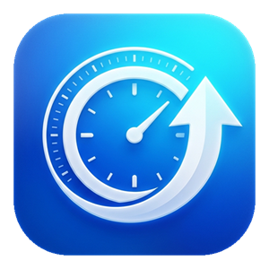

# AppWatch

<p align="center">
  
</p>

<p align="center">
  <strong>Быстрый и умный менеджер обновлений для приложений Windows desktop.</strong><br>
  Отслеживание и обновление программ из GitHub Releases, WinGet, портативных архивов, исполняемых файлов и сторонних апдейтеров в едином интерфейсе Fluent Design.
</p>

<p align="center">
  <a href="README.md">English</a> • <a href="README.ru.md"><b>Русский</b></a>
</p>

<p align="center">
  <a href="https://github.com/skllfi2/AppWatch/actions/workflows/ci.yml"></a>
  <a href="https://github.com/skllfi2/AppWatch/releases"></a>
  <a href="https://dotnet.microsoft.com/download/dotnet/10.0"></a>
  <a href="https://learn.microsoft.com/windows/apps/winui/winui3/"></a>
  <a href="LICENSE"></a>
</p>

---

## Ключевые возможности

| Возможность | Описание |
|---|---|
| **Мульти-источники** | Поддержка **GitHub Releases** (портативные zip, одиночные exe, инсталляторы), пакетов **WinGet**, локальных программ и **внешних** средств обновления (таких как Battle.net или Steam). |
| **Нативный интерфейс WinUI 3** | Интерфейс в стиле Windows 11 Fluent Design с материалом Mica, адаптивной навигацией и переключением тем (Светлая, Темная, Системная). |
| **Звуковая система** | Нативные системные звуки WinUI 3 для действий пользователя, смены статусов и уведомлений с возможностью отключения в настройках. |
| **Умный поиск иконок** | Извлечение иконок высокого разрешения напрямую из исполняемых файлов через Win32 Shell API с безопасным освобождением дескрипторов GDI и эвристическим поиском в репозиториях GitHub (`assets/icon.png`, `logo.png`). |
| **Системный сканер** | Автоматический поиск установленных в системе приложений через реестр Windows (ARP) и WinGet без захламления списка. |
| **Импорт из GitHub Stars** | Пакетный импорт репозиториев из вашего списка избранного GitHub Stars, выпускающих сборки под Windows, в один клик. |
| **Фильтры источников и статусов** | Быстрая фильтрация больших списков по источникам (**GitHub**, **WinGet**, **External**) и статусам (**Обновления**, **Ошибки**, **Актуально**). |
| **Контроль запущенных процессов** | Проверка активности программы перед обновлением для предотвращения блокировки файлов (`Access Denied`) с опцией автоматического перезапуска. |
| **Фоновые проверки и сброс памяти** | Ненавязчивые периодические фоновые проверки с единым суммарным уведомлением Windows и автоматическим сбросом рабочей памяти (`EmptyWorkingSet`) до 40-60 МБ. |
| **Локализация** | Полная поддержка двух языков (русский и английский) с мгновенным переключением в приложении. |

---

## Установка

### Через GitHub Releases (рекомендуется)
1. Перейдите на страницу [Releases](https://github.com/skllfi2/AppWatch/releases/latest).
2. Скачайте `AppWatch-win-Setup.exe` (инсталлятор Velopack с поддержкой автообновления) или `AppWatch-win-Portable.zip`.
3. Запустите `AppWatch.exe`.

### Через диспетчер пакетов Windows (WinGet)
```powershell
winget install AppWatch
```

---

## Архитектура и стек технологий

AppWatch построен по принципам **Clean Architecture** и паттерну **MVVM**:

```
AppWatch/
├── src/
│   ├── AppWatch.Core/            # Чистый домен: модели, эвристики, политики обновлений, интерфейсы
│   │                            # Без зависимостей от UI и специфичных API ОС.
│   │
│   ├── AppWatch.Infrastructure/  # Реализации: клиент GitHub API, сервис WinGet,
│   │                            # управление процессами, сканеры реестра, файловые хранилища.
│   │
│   └── AppWatch.App/             # Слой представления WinUI 3: Views, ViewModels, конвертеры,
│                                # токены дизайн-системы, звуковые эффекты и словарь локализации.
│
├── tests/
│   └── AppWatch.Core.Tests/      # Набор модульных тестов xUnit (436 тестов, 100% успешное прохождение).
│
├── docs/                         # Документация архитектуры, ADR, руководство по участию.
└── .github/                      # CI/CD воркфлоу, шаблоны задач, конфигурация dependabot.
```

* **Платформа**: .NET 10 (`net10.0-windows10.0.17763.0`)
* **Интерфейс**: Windows App SDK (WinUI 3) + материал Mica
* **MVVM**: CommunityToolkit.Mvvm (Source Generators)
* **Инсталлятор и обновления**: Velopack (дельта-обновления с проверкой Authenticode)

---

## Сборка из исходного кода

### Требования
* Windows 10 (версия 1809, сборка 17763+) или Windows 11
* Visual Studio 2022 (v17.11+) или Visual Studio 2026 Preview с рабочей нагрузкой *Разработка классических приложений .NET*
* [.NET 10 SDK](https://dotnet.microsoft.com/download/dotnet/10.0)

### Быстрая сборка и запуск тестов
```powershell
# Клонирование репозитория
git clone https://github.com/skllfi2/AppWatch.git
cd AppWatch

# Сборка под архитектуру x64
dotnet build -p:Platform=x64

# Запуск тестов
dotnet test -p:Platform=x64
```

---

## Конфигурация

AppWatch сохраняет настройки пользователя и список отслеживаемых приложений в файле `%APPDATA%\AppWatch\config.json`:

```json
{
  "theme": "System",
  "language": "ru",
  "backgroundCheckEnabled": true,
  "backgroundCheckIntervalHours": 4,
  "soundEffectsEnabled": true,
  "autoApplyConsent": false,
  "trackedApps": [
    {
      "name": "ripgrep",
      "repoOwner": "BurntSushi",
      "repoName": "ripgrep",
      "updateKind": 0,
      "executableName": "rg.exe",
      "enabled": true
    }
  ]
}
```

---

## Участие в разработке (Contributing)

Мы рады предложениям и улучшениям! Ознакомьтесь с [Contributing Guide](CONTRIBUTING.md) и [Code of Conduct](CODE_OF_CONDUCT.md) перед созданием Pull Request.

---

## Лицензия

Проект распространяется под [лицензией MIT](LICENSE). Благодарности сторонним библиотекам перечислены в файле [NOTICE](NOTICE).
