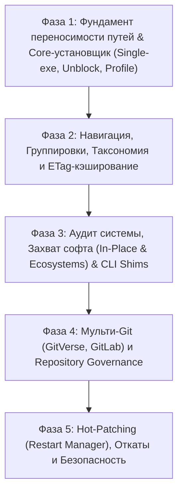

# AppWatch: Стратегия развития, позиционирование и путь к статусу Must-Have

> **Документ стратегического видения, архитектурного анализа и бэклог развития проекта AppWatch**  
> Дата актуализации: Ноябрь 2026 г.  
> Цель: Вывести AppWatch в топ инструментов для разработчиков и power-юзеров Windows, трансформировав проект из добротного GUI-менеджера в незаменимый системный инструмент управления софтом.

---

## 1. Позиционирование и рыночная идентичность

### Проблема рынка
Существующие решения поляризованы и оставляют гигантский разрыв:
- **Пакетные менеджеры (UniGetUI / WinGet / Scoop / Chocolatey):** видят только то, что официально занесено в их манифесты. При этом огромная масса инди-софта, CLI-утилит, ИИ-агентов и форков публикуется напрямую в Git-релизах и не попадает в официальные репозитории.
- **Трекеры Git-релизов (GitHub Release Notifier и др.):** лишь присылают ссылки в браузер; они не умеют загружать, распаковывать portable zip, атомарно менять файлы, убивать блокирующие процессы и восстанавливать окружение.
- **Ручное управление софтом на «живой» рабочей системе:** пользователи годами ставили софт кто во что горазд — распаковывали в `D:\Tools` или `C:\bin`, ставили через скрипты `curl | sh`, глобальные пакеты `npm`/`cargo`/`pipx`, скачивали standalone бинарники. Связь с апстримом утеряна, половина инструментов устарела, а переустановка системы означает мучительный сбор софта с нуля.

### Ключевой слоган и позиционирование
> **«The Missing App Manager for Developers & Power Users on Windows»**  
> *(Единый центр управления софтом: берет под контроль то, что уже установлено годами, и то, что живёт в Git-экосистемах (GitHub, GitVerse, GitLab))*

### Целевые сегменты аудитории
1. **Разработчики и DevOps-инженеры:** десятки CLI-утилит (ripgrep, lazydocker, lazygit, fzf, yt-dlp, Neovim, k9s, kubectl-плагины, ИИ-рантаймы вроде oh-my-openagent), серверов и софта для разработки.
2. **Open-Source энтузиасты:** сотни избранных репозиториев в Stars/Избранном (GitHub, GitVerse, GitLab), предпочтение portable-версиям без реестрового мусора и инсталляторов.
3. **Владельцы «нажитых» систем:** пользователи с давно настроенными рабочими ПК, которым нужен аудит и наведение порядка в уже установленном софте без поломки существующих путей.
4. **Пользователи из РФ/СНГ и корпоративный сектор:** активный переход на отечественные и независимые платформы (**GitVerse**, корпоративные инстансы **GitLab / Gitea**).

---

## 2. Ключевые архитектурные направления и фичи

### 📦 Направление 1. Глубокий аудит и захват софта на работающей системе (System Audit & Adoption Engine)
*Ответ на фундаментальный вопрос: «Что делать, если системе уже несколько лет, софт разбросан повсюду, ставился через npm, cargo, скрипты или вручную?»*

- **1. Сканирование системного ландшафта (System Landscape Scanner):**
  - **Аудит пользовательского и системного `%PATH%`:** автоматическое обнаружение всех бинарников, доступных в терминале.
  - **Аудит стандартных директорий размещения софта:**
    - Пользовательские папки: `C:\bin`, `C:\Tools`, `D:\PortableApps`, `%USERPROFILE%\bin`, `%LOCALAPPDATA%\Programs`.
    - Пакетные менеджеры языковых экосистем:
      - **Cargo (Rust):** `%USERPROFILE%\.cargo\bin` (детект через `cargo install --list`);
      - **Node/NPM:** `%APPDATA%\npm`, pnpm global, bun global (`bun pm -g ls`, `npm list -g --depth=0`);
      - **Python/Pipx:** `%USERPROFILE%\.local\bin`, `%APPDATA%\Python\Scripts` (`pipx list`);
      - **Go:** `%USERPROFILE%\go\bin`;
      - **.NET Global Tools:** `%USERPROFILE%\.dotnet\tools` (`dotnet tool list -g`).
    - Скриптовые инсталляторы (например, `~/.omo/bin`, `~/.ollama/bin`).
- **2. Движок обратного сопоставления с репозиториями (Reverse Repo Matcher):**
  - Чтение PE-метаданных исполняемых файлов (`FileVersionInfo`: `ProductName`, `CompanyName`, `LegalCopyright`, `Comments`). Зачастую ссылка на репозиторий GitHub зашита прямо в PE-заголовок.
  - Опрос версии через CLI: запуск `tool.exe --version` / `-v` через безопасный изолятор `VersionDetector`.
  - Поиск в локальном каталоге `CatalogSearch` (содержит тысячи соответствий известных утилит их GitHub/GitVerse репозиториям).
  - Фоновый запрос к GitHub Search API по имени исполняемого файла / названию проекта при отсутствии в локальном каталоге.
- **3. Интерактивный мастер аудита («System Audit & Adoption Wizard»):**
  - Показывает понятный отчет:
    - *«Найдено 42 утилиты в PATH и директориях»*;
    - *«28 утилит точно сопоставлены с GitHub/GitVerse репозиториями»*;
    - *«6 утилит управляются через Cargo/npm/pipx»*;
    - *«8 утилит требуют ручной подсказки репозитория»*.
  - **Два режима захвата на выбор пользователя:**
    - **In-Place Adoption (Захват на месте):** исходные файлы и директории **не перемещаются** (чтобы не сломать внешние скрипты пользователя). AppWatch просто сохраняет их путь в `TrackedApp.InstallDirectory` и берёт на себя мониторинг и доставку обновлений прямо в эту папку.
    - **Consolidation / Migrate to AppWatch (Консолидация):** перенос софта в управляемую директорию AppWatch с автоматическим созданием CLI Shims в `%PATH%`.
- **4. Поддержка консольных инструментов (Console / Package-Managed Tools):**
  - В `UpdateKind` добавляется стратегия: `UpdateKind.ConsoleTool` / `CustomCommand`.
  - Поля: `CheckVersionCommand` (например, `cargo install --list`), `UpdateCommand` (например, `cargo install-update -a` или `npm i -g @user/pkg@latest`).
  - Если утилита ставилась через `npm`/`cargo`/`pipx`, AppWatch обновляет её через запуск штатного диспетчера пакетов с выводом лога в UI.

### 💾 Направление 2. Переносимость, резервное копирование и изоляция (Portability & Core Engine)
- **Токенизация путей (Portable Path Macros):**
  - В сериализации `TrackedApp.InstallDirectory` хранятся не абсолютные пути (`C:\Users\...\AppData\...`), а переносимые макросы: `%APPS%/<AppName>`, `%LOCALAPPDATA%`, `%USERPROFILE%`, `%SYSTEMDRIVE%`.
  - При смене пользователя, буквы диска или переносе папки пути автоматически переразрешаются.
- **Безопасный экспорт и импорт профиля («One-Click Manifest»):**
  - **Манифест приложений (`appwatch-manifest.json`):** открытый переносимый список приложений, категорий, тегов и параметров установки. Секреты (токены) автоматически исключаются (Redacted), файл безопасен для публикации в dotfiles.
  - **Полный бэкап профиля (`appwatch-backup.zip` / зашифрованный JSON):** экспорт с сохранением токенов с использованием Windows Data Protection API (DPAPI) или мастер-пароля.
  - **Режим регидратации на новом ПК:**
    - *Только привязка* (если папка с софтом уже скопирована с внешнего диска);
    - *Полное развертывание* (фоновое автоматическое скачивание актуальных версий всех программ из списка).
- **True Portable Mode:**
  - При наличии файла `portable.flag` рядом с `AppWatch.exe` база данных, конфиги и папка `Apps` хранятся внутри каталога приложения (для работы с внешнего SSD/флешки).
- **Поддержка Single-file Binary Releases и вариантов компиляции:**
  - Загрузка и обновление одиночных `.exe` без zip-контейнеров (распространенный формат релизов на Go/Rust/Bun/Node).
  - Умный выбор вариантов бинарников: фильтрация вспомогательных/десктопных подкомпонентов и правильный выбор между вариантами сборки (например, `baseline` vs стандартный x64 с поддержкой AVX2, ARM64 vs x64).
- **Снятие блокировки Mark-of-the-Web (Zone.Identifier):**
  - Автоматическое снятие потока `:Zone.Identifier` (`Unblock-File`) после скачивания и верификации контрольной суммы, избавляющее от диалогов SmartScreen.

### 🧭 Направление 3. Умная навигация, таксономия и плотный вид (Navigation & Organization)
- **Категоризация и таксономия в `TrackedApp`:**
  - Предустановленные системные категории: `Dev Tools & CLI`, `AI & LLM Tools`, `Media & Graphics`, `System Utilities`, `Internet & Network`, `Productivity`, `Uncategorized`.
  - Пользовательские цветные теги (например, `#work`, `#daily`, `#portable`, `#terminal`).
  - Фиксация источника добавления (`SourceOrigin`): `GitHub Releases`, `GitVerse`, `GitLab`, `WinGet`, `Local In-Place`, `Imported from Stars`, `Cargo/NPM Tool`.
- **Группировка и фильтры в UI (WinUI 3 `CollectionViewSource`):**
  - Переключение режимов группировки:
    - *По категории/направлению* (сворачиваемые Expander-секции);
    - *По источнику добавления* (GitHub, GitVerse, WinGet, Локальные In-Place, Пакетные менеджеры);
    - *По статусу обновления* (Требует обновления, Актуально, Зафиксировано/Pinned, Ошибка).
  - Быстрые чипы-фильтры (Pill Chips) в шапке: `Все`, `Только обновления`, `CLI / Shims`, `AI Tools`, `Portable`, `WinGet`.
- **Режимы отображения списка:**
  - **Cards Grid** — карточки с аватарами (для презентабельного вида);
  - **Dense DataGrid / Compact Table View** — компактная таблица с сортировкой по колонкам (Имя, Версия, Доступная версия, Категория, Источник, Дата проверки, Действия) — критично для списков 50–200+ утилит.
- **Оптимизация квот API и защита от блокировок (Rate Limiting & ETag Caching):**
  - Поддержка заголовков `If-None-Match` / `ETag` (GitHub API не списывает лимит запросов при ответе `304 Not Modified`).
  - Адаптивная очередь проверки релизов (Priority Queue) для стабильной работы со 100+ репозиториями без GitHub-токена.

### 🚀 Направление 4. Мульти-Git экосистема (GitVerse, GitLab, Gitea)
- Реализация единого контракта `IGitReleaseClient`.
- Поддержка **GitVerse** (Gitea API v1 с персональными токенами).
- Поддержка **GitLab** (GitLab REST API v4, работа с `projects/:id/releases`, публичные и self-hosted инстансы).
- Безопасное хранение токенов в Windows Credential Locker (`DataProtectionProvider` / DPAPI).
- **Управление видимостью и фильтрация (Repository Governance):**
  - Черный список паттернов (`*-docs`, `test-*`).
  - Селективный предпросмотр при импорте из Stars.

### 🛡️ Направление 5. Отказоустойчивость, Hot-Patching и безопасность
- **Hot-Patching / In-Use File Replacement:**
  - Определение занятых процессов через Windows Restart Manager API (`rstrtmgr.dll`).
  - Временное переименование заблокированного `.exe` в `.old_tmp` с отложенным удалением, предотвращая сбои «Access Denied» при обновлении открытой программы.
- **Откат версий в 1 клик (Rollback Engine):**
  - Локальный версионный кэш (`%LOCALAPPDATA%\AppWatchData\Versions\<app>\<tag>`) с возможностью мгновенного возврата к предыдущей стабильной сборке.
- **Защита целостности:**
  - Сверка контрольных сумм по приложенным `checksums.txt` / `SHA256SUMS`.
  - Опциональная проверка через VirusTotal API перед установкой.

---

## 3. Скорректированный порядок реализации (Roadmap Phasing)

Логика фаз синхронизирована с техническими зависимостями компонентов:

### 📍 Фаза 1. Фундамент переносимости путей и Core-установщика (Data Portability & Core Engine)
> **Цель:** Исключить поломку путей при любых сценариях переноса, поддержать установку любых бинарников (включая одиночные exe и multi-asset релизы вроде oh-my-openagent).
1. **Токенизация путей установки (`PathMacroResolver`):**
   - Перевод `TrackedApp.InstallDirectory` на динамические токены (`%APPS%`, `%LOCALAPPDATA%`, `%USERPROFILE%`, `%SYSTEMDRIVE%`).
   - Поддержка произвольных путей с сохранением признака `IsInPlaceInstall` (не удалять папку пользователя при удалении из трекинга).
2. **Поддержка Single-file Binary Releases в `UpdateEngine`:**
   - Скачивание одиночных `.exe` без архивации с атомарной подменой целевого файла.
   - Улучшение `AssetSelector`: поддержка выбора между baseline и оптимизированными сборками, фильтрация вспомогательных бинарников.
3. **Снятие Mark-of-the-Web:**
   - Удаление потока `:Zone.Identifier` после скачивания ассетов (`Unblock-File`).
4. **Экспорт и Импорт профиля (`ProfileManager`):**
   - Экспорт безопасного манифеста `appwatch-manifest.json` (без секретов) и полного бэкапа (с DPAPI).
   - Мастер импорта с режимами: «Только трекинг» и «Полная регидратация (Rehydrate)».
5. **Поддержка Portable Mode:**
   - Автодетект маркера `portable.flag` и переключение корней путей внутрь директории приложения.

### 📍 Фаза 2. Улучшение навигации списка, таксономия и ETag (Smart Navigation & Scalability)
> **Цель:** Сделать коллекцию из 50–200 приложений удобной и исключить превышение лимитов GitHub API.
1. **Расширение модели данных (`TrackedApp`):**
   - Добавление полей `Category`, `Tags` (`List<string>`), `SourceOrigin`.
2. **Группировка в UI (`CollectionViewSource`):**
   - Переключатель группировки: «По категориям», «По источнику», «По статусу обновления».
   - Сворачиваемые секции (Expander) с индикатором количества программ в группе.
3. **Фильтрация и быстрый поиск:**
   - Чипы-фильтры (Pills): «Все», «Обновления», «CLI / Shims», «AI Tools», «Portable», «Ошибки».
4. **Компактный режим (Compact Grid / DataGrid View):**
   - Альтернативный табличный режим отображения для больших коллекций.
5. **Кэширование ETag / 304 Not Modified:**
   - Сохранение ETag последнего релиза, позволяющее проверять обновления сотен программ без исчерпания часового лимита API.

### 📍 Фаза 3. Глубокий аудит системы, Захват софта и CLI Shims (System Adoption Engine)
> **Цель:** Навести порядок на живой рабочей машине — за 1 минуту обнаружить весь разрозненный софт и взять его под единый контроль обновлений.
1. **Системный аудитор (`SystemScanner`):**
   - Сканирование системного и пользовательского `%PATH%`.
   - Обнаружение инструментов в экосистемах: Cargo (`.cargo/bin`), npm global, pipx (`.local/bin`), Go (`go/bin`), .NET tools.
   - Чтение метаданных PE (`FileVersionInfo`) и проверка версий через изолированный `VersionDetector`.
2. **Reverse Repository Matcher:**
   - Автоматическое сопоставление обнаруженных исполняемых файлов с репозиториями через локальный каталог и API поиска GitHub/GitVerse.
   - Механизм дедупликации (склейка с уже отслеживаемыми приложениями).
3. **Интерактивный UI Мастера аудита и захвата:**
   - Сводный экран: распределение по найденным источникам с возможностью пакетного принятия под контроль.
   - Выбор режима: **In-Place** (оставить в текущей папке) или **Consolidate** (перенести в `%APPS%`).
4. **Консольный исполнитель (`ConsoleToolRunner`):**
   - Поддержка обновления инструментов через их «родные» команды (`cargo install-update`, `npm update -g`, `pipx upgrade`) с выводом терминального лога в UI.
5. **Менеджер Shims (`ShimService`):**
   - Директория `%LOCALAPPDATA%\AppWatchData\shims`, зарегистрированная в `%PATH%`.
   - Автоматическая генерация symlink / `.cmd` / `.ps1` оберток для консольных программ.

### 📍 Фаза 4. Мульти-Git экосистема и управление репозиториями (GitVerse, GitLab)
> **Цель:** Полная независимость от монополии GitHub.
1. **Абстракция `IGitReleaseClient`:**
   - Единый контракт получения релизов и ассетов.
2. **Клиент GitVerse:**
   - Поддержка Gitea API v1 с авторизацией по токенам.
3. **Клиент GitLab:**
   - Поддержка GitLab Releases API v4 (публичные и self-hosted инстансы).
4. **Управление видимостью и фильтрами (Repository Governance):**
   - Черный список паттернов (`*-docs`, `test-*`).
   - Предпросмотр и селективный выбор при импорте из Stars.

### 📍 Фаза 5. Отказоустойчивость, Hot-Patching и безопасность (Hardening)
> **Цель:** Промышленная стабильность обновлений.
1. **Hot-Patching через Restart Manager API:**
   - Безопасное обновление запущенных приложений без краша доступа к файлу.
2. **Движок отката версий (Rollback Engine):**
   - Хранение локального версионного кэша и откат в 1 клик из контекстного меню.
3. **Сверка контрольных сумм и VirusTotal:**
   - Проверка SHA-256 по `checksums.txt` / `SHA256SUMS` / VirusTotal API.

---

## 4. Разбор сложных кейсов: Проекты со сложной структурой релизов (Кейс `oh-my-openagent`)

Репозиторий `code-yeongyu/oh-my-openagent` служит эталонным примером современного сложного open-source проекта (CLI + AI-агент). Анализ его релизов (`v5.1.62`) выявил следующие вызовы для AppWatch:

### Что содержится в релизе `oh-my-openagent`:
1. **Одиночные бинарники без архива:** `omo-windows-x64.exe`, `omo-windows-x64-baseline.exe`, `omo-windows-arm64.exe`.
2. **Несколько исполняемых файлов под одну ОС:**
   - Основной CLI-рантайм: `omo-windows-x64.exe`;
   - Вспомогательный движок рабочего стола: `senpi-desktop-engine-win32-x64.exe`.
3. **Варианты архитектур (Инструкции процессора):**
   - Стандартный (`omo-windows-x64.exe` с AVX2/современными инструкциями);
   - `baseline` (`omo-windows-x64-baseline.exe` для старых процессоров).
4. **Формат контрольных сумм:** приложен общий файл `SHA256SUMS` и специализированный `senpi-desktop-engine-checksums.txt`.

### Поведение AppWatch для таких проектов:
- **Выбор правильного бинарника:**
  - `AssetSelector` ранжирует имена ассетов. Так как целевое приложение называется `oh-my-openagent` (команда `omo`), эвристика совпадения имени отсекает сторонние подкомпоненты (`senpi-*`) в пользу основного `omo-*`.
  - При наличии нескольких подходящих вариантов под архитектуру пользователя (например, обычный и `baseline`), AppWatch по умолчанию выбирает основной современный бинарник, но предоставляет селектор ассета в карточке/диалоге добавления.
- **Установка и переименование:**
  - Так как файл распространяется как голый `.exe` (`Single-file Binary`), `UpdateEngine` помещает его в целевую папку и переименовывает в стандартное имя команды (`omo.exe`), создавая shim-заглушку в `%PATH%`.
- **Проверка хеша:**
  - Парсер контрольных сумм (`ChecksumParser`) корректно находит строку с `omo-windows-x64.exe` в файле `SHA256SUMS` и верифицирует целостность перед запуском.

---

## 5. Сводная матрица задач и ценности

| Фаза | Ключевая фича | Ценность для пользователя | Сложность |
|---|---|---|:---:|
| **Фаза 1** | Относительные пути, Single-file exe, Unblock Zone.Id, Backup & Restore, Portable | Полное спокойствие за данные, переезд на новый ПК в 1 клик, поддержка утилит на Go/Rust/Bun | Средняя |
| **Фаза 2** | Группировка (категории/источники), фильтры, Компактный вид, ETag кэш | Удобное управление сотней утилит без каши и без блокировок по квотам GitHub API | Средняя |
| **Фаза 3** | Аудит системы (PATH, Cargo, NPM, Pipx), In-Place Adoption, Shims | Наведение порядка в «нажитой» годами системе за 1 минуту; единый центр обновлений | Высокая |
| **Фаза 4** | Поддержка GitVerse, GitLab и репозиторный черный список | Импортозамещение, поддержка корпоративных и отечественных репозиториев | Высокая |
| **Фаза 5** | Hot-patching (Restart Manager), Rollback в 1 клик, SHA256 верификация | Защита от битых релизов и ошибок блокировки файлов («Access Denied») в Windows | Высокая |
