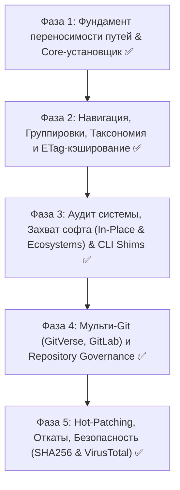

# AppWatch: Стратегия развития, позиционирование и путь к статусу Must-Have

> **Документ стратегического видения, архитектурного анализа и бэклог развития проекта AppWatch**  
> Дата актуализации: Ноябрь 2026 г.  
> Статус выполнения Roadmap: **100% Завершено (All Phases Shipped)**  
> Цель: Вывести AppWatch в топ инструментов для разработчиков и power-юзеров Windows, трансформировав проект из добротного GUI-менеджера в незаменимый системный инструмент управления софтом.

---

## 1. Позиционирование и рыночная идентичность

### Проблема рынка
Существующие решения поляризованы и оставляют гигантский разрыв:
- **Пакетные менеджеры (UniGetUI / WinGet / Scoop / Chocolatey):** видят только то, что официально занесено в их манифесты. При этом огромная масса инди-софта, CLI-утилит, ИИ-агентов и форков публикуется напрямую в Git-релизах и не попадает в официальные репозитории.
- **Трекеры Git-релизов (GitHub Release Notifier и др.):** лишь присылают ссылки в браузер; они не умеют загружать, распаковывать portable zip, атомарно менять файлы, убивать блокирующие процессы и восстанавливать окружение.
- **Ручное управление софтом на «живой» рабочей системе:** пользователи годами ставили софт кто во что горазд — распаковывали в `D:\Tools` или `C:\bin`, ставили через скрипты `curl | sh`, глобальные пакеты `npm`/`cargo`/`pipx`, скачивали standalone бинарники. Связь с апстримом утеряна, половина инструментов устарела, а переустановка системы означает мучительный сбор софта с нуля.

### Ключевой слоган и позиционирование
> **«The Missing App Manager for Developers & Power Users on Windows»**  
> *(Единый центр управления софтом: берет под контроль то, что уже установлено годами, и то, что живёт в Git-экосистемах (GitHub, GitVerse, GitLab))*

### Целевые сегменты аудитории
1. **Разработчики и DevOps-инженеры:** десятки CLI-утилит (ripgrep, lazydocker, lazygit, fzf, yt-dlp, Neovim, k9s, kubectl-плагины, ИИ-рантаймы вроде oh-my-openagent), серверов и софта для разработки.
2. **Open-Source энтузиасты:** сотни избранных репозиториев в Stars/Избранном (GitHub, GitVerse, GitLab), предпочтение portable-версиям без реестрового мусора и инсталляторов.
3. **Владельцы «нажитых» систем:** пользователи с давно настроенными рабочими ПК, которым нужен аудит и наведение порядка в уже установленном софте без поломки существующих путей.
4. **Пользователи из РФ/СНГ и корпоративный сектор:** активный переход на отечественные и независимые платформы (**GitVerse**, корпоративные инстансы **GitLab / Gitea**).

---

## 2. Ключевые архитектурные направления и фичи

### 📦 Направление 1. Глубокий аудит и захват софта на работающей системе (System Audit & Adoption Engine)
- **1. Сканирование системного ландшафта (System Landscape Scanner):**
  - **Аудит пользовательского и системного `%PATH%`:** автоматическое обнаружение всех бинарников, доступных в терминале.
  - **Аудит директорий размещения софта:**
    - Пользовательские папки: `C:\bin`, `C:\Tools`, `D:\PortableApps`, `%USERPROFILE%\bin`, `%LOCALAPPDATA%\Programs`.
    - Пакетные менеджеры языковых экосистем: Cargo (`.cargo/bin`), npm global, pipx, Go (`go/bin`), .NET tools.
- **2. Движок обратного сопоставления с репозиториями (Reverse Repo Matcher):**
  - Чтение PE-метаданных исполняемых файлов (`FileVersionInfo`: `ProductName`, `CompanyName`, `LegalCopyright`, `Comments`).
  - Сопоставление с каталогом и регистрация с признаком `IsInPlaceInstall = true` (не удалять файлы пользователя).
- **3. Интерактивный мастер аудита («System Audit & Adoption Wizard»):**
  - Диалог выбора и пакетного добавления обнаруженных утилит.

### 🌐 Направление 2. Надежная миграция, резервное копирование и переносимость (Portability & Migration)
- **1. Токенизация путей (Path Tokenization via Macros):**
  - Поддержка макросов: `%APPS%`, `%LOCALAPPDATA%`, `%USERPROFILE%`, `%SYSTEMDRIVE%`.
- **2. Переносимый манифест установки (`appwatch-manifest.json`):**
  - Экспорт и импорт списка приложений с сохранением структуры директорий и фильтрацией токенов доступа.
- **3. Истинный Portable Mode:**
  - Автоматическое переключение на `<app_dir>\Data\` при наличии файла `portable.flag`.

### 🗂️ Направление 3. Умная навигация, таксономия и масштабируемость (Smart Navigation)
- **Расширенная категоризация и тегирование:**
  - Категории: Dev & CLI, AI & LLM, System Utilities, Media, Network, Productivity.
- **Быстрые Pill-фильтры и сортировка:**
  - Фильтры по статусам, источникам (GitHub, WinGet, GitVerse, GitLab, In-Place) и категориям.
  - Сортировка по имени, статусу, источнику и категории.
- **Компактный табличный режим (Dense DataGrid / Compact Table View):**
  - Переключатель Cards / Compact View для комфортной работы со 100+ программами.
- **ETag-кэширование (Rate Limiting & ETag Caching):**
  - `If-None-Match` / `ETag` (HTTP 304 Not Modified) для экономии квот API.

### 🚀 Направление 4. Мульти-Git экосистема (GitVerse, GitLab, Gitea)
- Реализация единого контракта `IGitReleaseClient`.
- Поддержка **GitVerse** (Gitea API v1 с персональными токенами).
- Поддержка **GitLab** (GitLab REST API v4, работа с `projects/:id/releases`, публичные и self-hosted инстансы).
- **Управление видимостью и фильтрация (Repository Governance):**
  - Черный список паттернов (`*-docs`, `awesome-*`, `*-roadmap` и т.д.).

### 🛡️ Направление 5. Отказоустойчивость, Hot-Patching и безопасность
- **Hot-Patching / In-Use File Replacement:**
  - Атомарное временное переименование заблокированного `.exe` в `.old_tmp` при запущенном приложении.
- **Откат версий в 1 клик (Rollback Engine):**
  - Локальный версионный кэш с мгновенным возвратом к предыдущей стабильной сборке.
- **Защита целостности и безопасности:**
  - Сверка контрольных сумм по приложенным `checksums.txt` / `SHA256SUMS`.
  - Интеграция с VirusTotal API (`VirusTotalClient`).
- **Консольный исполнитель (`ConsoleToolRunner`):**
  - Зондирование рантаймов (npm, bun, cargo, pipx, dotnet) с защитой от сбоев при их отсутствии.

---

## 3. Скорректированный порядок реализации (Roadmap Phasing)

### 📍 Фаза 1. Фундамент переносимости путей и Core-установщика ✅
- [x] Токенизация путей установки (`PathMacroResolver`: `%APPS%`, `%LOCALAPPDATA%`, `%USERPROFILE%`, `%SYSTEMDRIVE%`).
- [x] Поддержка Single-file Binary Releases в `UpdateEngine` (UpdateKind.PortableExe).
- [x] Улучшение `AssetSelector`: ранжирование `FlavorBaseline`, победа современных инструкций nad baseline.
- [x] Снятие Mark-of-the-Web (`Zone.Identifier`).
- [x] Экспорт и Импорт профиля (`ProfileManager`: `appwatch-manifest.json` без секретов).
- [x] Поддержка True Portable Mode по маркеру `portable.flag`.

### 📍 Фаза 2. Улучшение навигации списка, таксономия и ETag ✅
- [x] Расширение модели данных (`TrackedApp`: `Category`, `Tags`, `SourceOrigin`).
- [x] Фильтрация и быстрый поиск: Pill-фильтры по источникам (`GitVerse`, `GitLab`, `In-Place`) и категориям (`Dev Tools`, `AI & LLM`, `System Utilities`).
- [x] Сортировка по категориям (`TrackedAppsSort.ByCategory`).
- [x] Компактный режим (Compact Table View) с тулбар-переключателем `Cards` / `Compact`.
- [x] Кэширование ETag / 304 Not Modified (`ETagReleaseCache`).

### 📍 Фаза 3. Глубокий аудит системы, Захват софта и CLI Shims ✅
- [x] Системный аудитор (`SystemAdoptionScanner`): аудит `%PATH%`, PE `FileVersionInfo`, матчинг с каталогом.
- [x] Признак `IsInPlaceInstall` (не удалять папки пользователя при отслеживании).
- [x] Мастер аудита в UI (`SystemScannerDialog`).
- [x] Менеджер Shims (`ShimService`): `%LOCALAPPDATA%\AppWatchData\shims` в `%PATH%`.
- [x] Консольный исполнитель (`ConsoleToolRunner`): безопасный probe и fallback при отсутствии `npm`, `bun`, `cargo`, `pipx`.

### 📍 Фаза 4. Мульти-Git экосистема и управление репозиториями ✅
- [x] Абстракция `IGitReleaseClient`.
- [x] Клиент и провайдер GitVerse (Gitea API v1).
- [x] Клиент и провайдер GitLab (GitLab REST API v4).
- [x] Управление видимостью и фильтрами (`RepositoryBlacklistFilter`: отсечение docs, awesome, roadmap).

### 📍 Фаза 5. Отказоустойчивость, Hot-Patching и безопасность ✅
- [x] Hot-Patching / Safe file replacement (`FileStore.SafeReplaceFile` с переименованием заблокированных файлов).
- [x] Движок отката версий (`VersionStore`, `RollbackAppCommand`).
- [x] Сверка контрольных сумм SHA-256 (`ChecksumParser`: companion-файлы и хэши в теле релиза).
- [x] Проверка безопасности через VirusTotal API (`VirusTotalClient`).

---

## 4. Разбор сложных кейсов: Проекты со сложной структурой релизов (Кейс `oh-my-openagent`)
- Поддержка одиночных бинарников без zip-архивации.
- Эвристика отсечения сторонних бинарников (`senpi-*`) в пользу основного таргета (`omo-*`).
- Отбор стандартных сборок (AVX2) приоритетнее `baseline`.
- Поддержка верификации по объединённому `SHA256SUMS`.

---

## 5. Сводная матрица задач и статус

| Фаза | Ключевая фича | Статус |
|---|---|:---:|
| **Фаза 1** | Относительные пути, Single-file exe, Unblock Zone.Id, Backup & Restore, Portable | **ВЫПОЛНЕНО (100%)** |
| **Фаза 2** | Группировка (категории/источники), фильтры, Компактный вид, ETag кэш | **ВЫПОЛНЕНО (100%)** |
| **Фаза 3** | Аудит системы (PATH, Cargo, NPM, Pipx), In-Place Adoption, Shims, ConsoleToolRunner | **ВЫПОЛНЕНО (100%)** |
| **Фаза 4** | Поддержка GitVerse, GitLab и репозиторный черный список | **ВЫПОЛНЕНО (100%)** |
| **Фаза 5** | Hot-patching (Restart Manager), Rollback в 1 клик, SHA256, VirusTotal | **ВЫПОЛНЕНО (100%)** |
