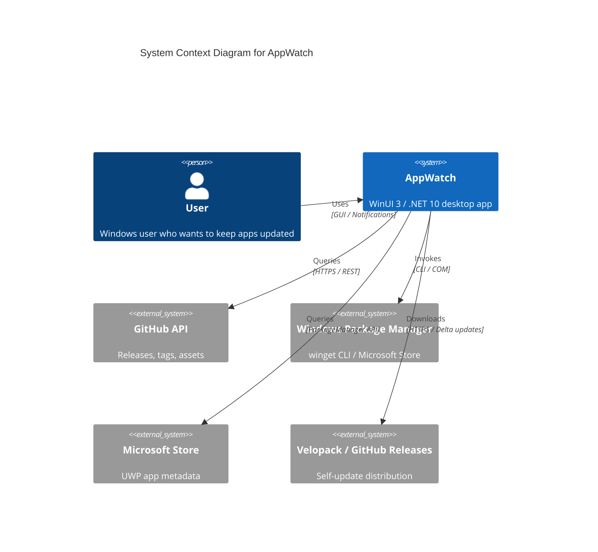
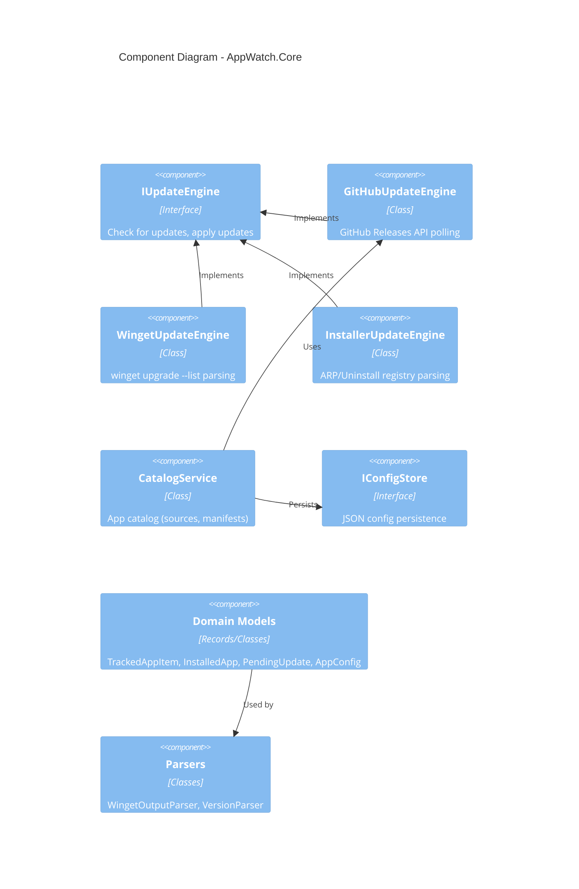
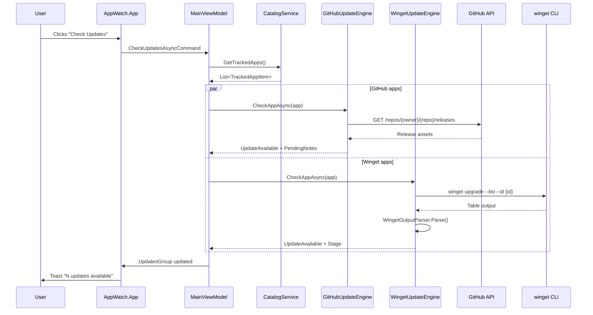
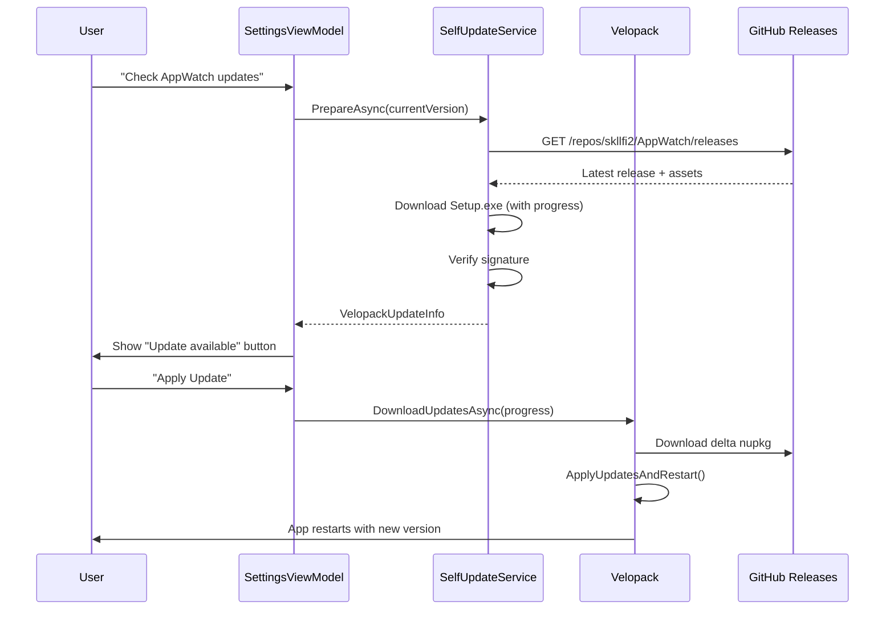
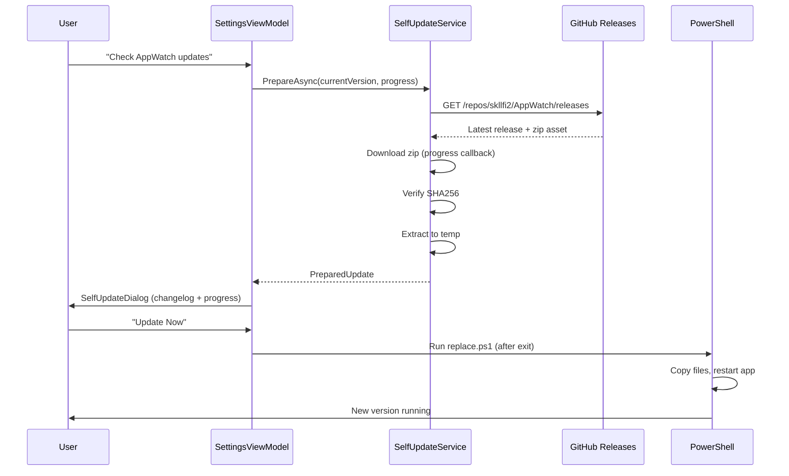

# AppWatch Architecture

## Overview
AppWatch is a Windows application that monitors and manages updates for installed applications from multiple sources (GitHub Releases, winget, portable apps, installers).

---

## C4 Context Diagram



---

## C4 Container Diagram

```mermaid
C4Container
title Container Diagram for AppWatch

Container(app, "AppWatch.App", "WinUI 3, .NET 10", "UI shell, NavigationView, pages, dialogs, toasts")
Container(core, "AppWatch.Core", ".NET 10", "Domain models, abstractions, update engines, parsers")
Container(infra, "AppWatch.Infrastructure", ".NET 10", "GitHub client, Winget service, Config store, Icon extractor, Self-update")
ContainerDb(config, "Config Store", "JSON (%APPDATA%)", "Tracked apps, settings, catalog, theme")
ContainerDb(logs, "Logs", "Text files (%APPDATA%)", "App logs, crash logs, scan logs")

Rel(app, core, "Uses", "DI / Interfaces")
Rel(app, infra, "Uses", "DI / Services")
Rel(app, config, "Reads/Writes", "IConfigStore")
Rel(core, infra, "Implements", "Abstractions")
Rel(infra, github, "Calls", "HTTPS / Octokit")
Rel(infra, winget, "Invokes", "winget.exe")
Rel(infra, config, "Persists", "JSON")
Rel(infra, logs, "Writes", "Serilog")
```

---

## C4 Component Diagram (Core)



---

## Key Design Decisions (ADRs)

See [Architecture Decision Records](adr/) for detailed decisions:

| ADR | Title | Status |
|-----|-------|--------|
| 001 | Clean Architecture with Core/Infra/App separation | Accepted |
| 002 | MVVM with CommunityToolkit.Mvvm | Accepted |
| 003 | WinUI 3 with NavigationView shell | Accepted |
| 004 | Dual update distribution: Velopack + Zip fallback | Accepted |
| 005 | Single consolidated notification (not per-app) | Accepted |
| 006 | Background update check with dispatcher marshaling | Accepted |
| 007 | JSON config + typed localization keys | Accepted |
| 008 | No neural search (tokenizer too large) | Accepted |
| 009 | UWP apps via PackageManager + ARP for Win32 | Accepted |
| 010 | Self-update dialog with changelog + progress | Accepted |

---

## Data Flow: Update Check



---

## Data Flow: Self-Update (Velopack)



---

## Data Flow: Self-Update (Zip Fallback)



---

## Security Considerations

| Area | Approach |
|------|----------|
| **Code signing** | Authenticode for .exe/.msix (CI) |
| **Update verification** | SHA256 checksums (zip), Velopack signatures (Velopack) |
| **GitHub API** | Optional PAT for higher rate limits (stored in config) |
| **winget** | Uses system winget (trusted Microsoft binary) |
| **Config** | JSON in %APPDATA% (user-writable, no elevation) |
| **Logs** | No secrets, PII minimized |

---

## Performance Targets

| Metric | Target |
|--------|--------|
| Cold start (UI visible) | < 1.5 s |
| Working set (idle) | < 150 MB |
| GC Gen2 heap | < 10 MB |
| Update check (10 apps) | < 5 s |
| winget scan | < 3 s |
| Installed apps scan (ARP + UWP) | < 2 s |

---

## Deployment

| Channel | Method |
|---------|--------|
| **Stable** | GitHub Releases (Velopack .exe) + winget manifest PR |
| **Preview** | GitHub Releases (pre-release tag) + Velopack channel |
| **Portable/Dev** | Zip artifact from GitHub Actions |
| **Uninstall** | Velopack uninstaller / winget uninstall / Settings dialog |

---

## Extensibility Points

| Extension | Interface | Implementation |
|-----------|-----------|----------------|
| New update source | `IUpdateEngine` | `GitHubUpdateEngine`, `WingetUpdateEngine`, `InstallerUpdateEngine` |
| New catalog source | `ICatalogSource` | `GitHubCatalogSource`, `WingetCatalogSource`, `StaticCatalogSource` |
| New notification | `IToastService` | `ToastService` (Windows toasts) |
| New config backend | `IConfigStore` | `JsonConfigStore` |
| New icon source | `IIconExtractor` | `IconExtractor` (Win32 + UWP) |